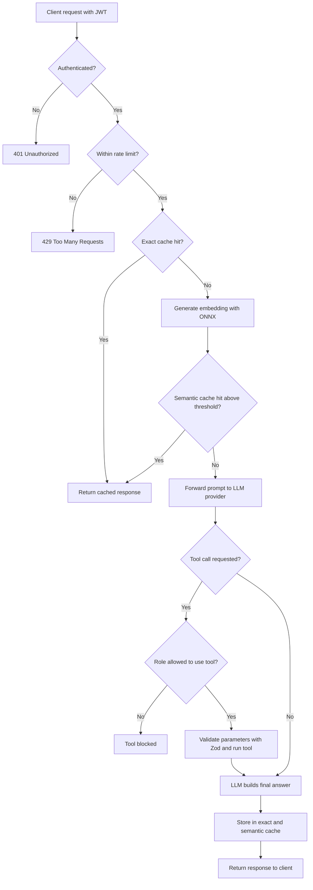

# AgentGate 🚀
 
> An agent-aware LLM gateway that sits between your applications and LLM providers to cache, secure, rate-limit, and monitor every interaction, including dynamic tool execution, in real time.
 


 
---
 
## Table of Contents
 
1. [What is AgentGate?](#-what-is-agentgate)
2. [The Problem It Solves](#-the-problem-it-solves)
3. [Key Features](#-key-features)
4. [How a Request Flows Through the Gateway](#-how-a-request-flows-through-the-gateway)
5. [Dual-Layer Caching Explained](#-dual-layer-caching-explained)
6. [Security, RBAC and Guardrails](#-security-rbac-and-guardrails)
7. [Agent Tools](#-agent-tools)
8. [Rate Limiting](#-rate-limiting)
9. [Project Structure](#-project-structure)
10. [Tech Stack](#-tech-stack)
11. [Setup and Installation](#-setup-and-installation)
12. [Environment Variables](#-environment-variables)
13. [Running the Gateway](#-running-the-gateway)
14. [Testing the Gateway](#-testing-the-gateway)
15. [Troubleshooting](#-troubleshooting)
16. [Roadmap](#-roadmap)
17. [Contributing](#-contributing)
18. [License](#-license)
---
 
## 🎯 What is AgentGate?
 
**AgentGate** is a custom-built middleware gateway that sits between client applications and LLM providers such as OpenAI or OpenRouter.
 
Without a gateway, every application talks directly to a paid LLM API. That leads to repeated spending on near-identical questions, slow responses, and no central place to enforce who is allowed to do what. AgentGate acts as a **control plane** in the middle and handles all of this in one place:
 
- **Multi-tier caching** (exact match and semantic match) so repeated questions never hit the LLM twice.
- **Role-Based Access Control (RBAC)** so users only reach the tools their role allows.
- **Input validation** so malformed or malicious tool parameters are stopped before they run.
- **Rate limiting** with a sliding-window approach.
- **Agent tool orchestration** so the LLM can call tools (weather, location, currency and more) safely from a single hub.
---
 
## 💡 The Problem It Solves
 
Putting LLMs and autonomous agents into production exposes teams to four recurring problems:
 
| # | Problem | What happens without a gateway |
|---|---------|--------------------------------|
| 1 | **Rising API costs** | Users ask the same thing in different words ("What's the weather in Tokyo?" vs "Can you check Tokyo's weather?"). Each variation is billed as a fresh LLM call. |
| 2 | **High latency** | External LLM calls often take 1 to 3 seconds. In chat apps and agent workflows this adds up and hurts the experience. |
| 3 | **Authorization gaps** | LLMs do not understand your organisation's roles. A normal user could trigger an admin-level tool or expose sensitive records. |
| 4 | **No guardrails** | Unfiltered prompts can carry injected instructions or produce broken tool parameters. |
 
AgentGate was built to address exactly these bottlenecks from first principles.
 
---
 
## ✨ Key Features
 
- **Exact-match caching** with Redis for identical queries.
- **Semantic caching** using local ONNX embeddings and cosine similarity for queries that mean the same thing.
- **JWT authentication** on every request.
- **Role-based tool access** (for example, blocking standard users from privileged tools).
- **Role-isolated cache keys** so cached answers never leak across permission levels.
- **Zod schema validation** for tool parameters.
- **Sliding-window rate limiting** per client.
- **Pluggable agent tools** that live in their own folder and are easy to extend.
- **Persistent storage** in MongoDB for user profiles, logs, and state.
- **Provider flexibility** through the OpenRouter and OpenAI SDKs.
---
 
## 🔄 How a Request Flows Through the Gateway
 

 
In plain words:
 
1. **Authenticate**: the JWT is verified and the user's role is read.
2. **Rate limit**: the sliding window decides whether the request is allowed.
3. **Exact cache**: an identical prompt returns instantly from Redis.
4. **Semantic cache**: the prompt is turned into a vector and compared against earlier prompts. A close enough match returns the saved answer.
5. **LLM and tools**: only on a full cache miss does the request reach the LLM provider. If the model asks for a tool, the role check and Zod validation run first.
6. **Store and respond**: the new answer is cached for next time and returned to the client.
---
 
## ⚙️ Dual-Layer Caching Explained
 
### Layer 1: Exact-match cache (Redis)
 
If the incoming prompt string is identical to one seen before, the stored response is served straight from Redis. No embedding work and no LLM call are needed.
 
### Layer 2: Semantic cache (ONNX embeddings + Redis)
 
When the exact cache misses:
 
1. The prompt is converted into a vector embedding **locally** with an ONNX runtime model. No external embedding API is called, so this layer adds no per-request cost.
2. The vector is compared against previously stored query vectors in Redis using **cosine similarity**.
3. If a stored query is similar enough (above the similarity threshold), the gateway **bypasses the LLM provider entirely** and returns the cached answer.
**Example**
 
| Prompt | Result |
|--------|--------|
| "What is the current weather in Tokyo?" | Cache miss. Tool and LLM run, result stored (about 1.5 s). |
| "Can you check Tokyo weather right now?" | Semantic cache hit. No LLM call, no tool call, 0 tokens spent. |
 
**Impact:** in high-traffic scenarios with many repeated or similar questions, semantic caching can remove a large share of redundant LLM calls (estimated in the range of 40 to 60 percent depending on traffic patterns), which cuts token spend and brings response time down to milliseconds.
 
> Cache hit rate depends on how repetitive your real traffic is. Measure it on your own workload.
 
---
 
## 🛡️ Security, RBAC and Guardrails
 
Production AI systems need strict boundaries. AgentGate applies several layers:
 
- **JWT-based authentication.** Every request passes the authentication middleware. The gateway reads the user's role from the token.
- **Role-Based Access Control.** Tool execution is restricted by role. For example, a standard `user` cannot call privileged database tools that an `admin` can.
- **Role-isolated cache keys.** Cached entries are partitioned by role, so a response generated for an administrator is never served to a standard user, even if the prompts look identical.
- **Input validation with Zod.** Tool parameters are checked against strict schemas before execution, protecting the system from malformed payloads and injection attempts.
- **Secrets in environment variables.** Keys and connection strings are loaded from `.env` and never hard-coded.
---
 
## 🧰 Agent Tools
 
Tools are executable functions the LLM can ask the gateway to run. They live in the `tools/` folder. Examples included:
 
- Weather lookup
- Location lookup
- Currency conversion
Each tool goes through the same safety path: **role check, then Zod validation, then execution.** To add a new tool, create a file in `tools/`, define its Zod schema, and register it with the agent orchestrator in `agent.js`.
 
---
 
## 🚦 Rate Limiting
 
The `timestampsWindow/` module implements a **sliding-window rate limiter** backed by Redis. Instead of resetting a counter at fixed intervals, it tracks request timestamps inside a moving time window. This prevents the burst-at-the-boundary problem of fixed-window limiters and gives smoother protection against abuse.
 
---
 
## 📂 Project Structure
 
```text
AgentGate/
├── authentication/    # JWT verification and user permission parsing
├── config/            # Environment and application configuration loader
├── database/          # MongoDB connection and Mongoose persistence schemas
├── redisConnection/   # Redis client initialisation and exact caching logic
├── services/          # LLM provider routing, OpenRouter / OpenAI SDK integrations
├── timestampsWindow/  # Rate limiting and sliding-window request handlers
├── tools/             # Executable agent tools (weather, location, currency, etc.)
├── agent.js           # Core agent orchestrator, entry point, and pipeline loop
└── package.json       # Project dependencies and scripts
```
 
---
 
## 🧱 Tech Stack
 
| Area | Technology |
|------|-----------|
| Runtime | Node.js (ES Modules) |
| Framework | Express.js |
| Database | MongoDB with Mongoose ODM |
| Caching and vectors | Redis, ONNX Runtime (local embedding generation) |
| Security and auth | JSON Web Tokens (JWT), custom RBAC middleware |
| Validation | Zod |
| AI orchestration | OpenAI / OpenRouter SDKs |
 
---
 
## 🚀 Setup and Installation
 
### Prerequisites
 
Make sure these are installed or available before you start:
 
- **Node.js** v18.0 or higher
- **Redis**, either a local server on port `6379` or a cloud instance such as Upstash or Redis Cloud
- **MongoDB**, either a local instance or a free MongoDB Atlas cluster
- **An LLM API key** from OpenRouter or OpenAI
### Step 1: Clone the repository
 
```bash
git clone https://github.com/sawastik7-bit/AgentGate-Agent-Aware-LLM-Gateway-with-Semantic-Caching-Guardrails.git
cd AgentGate-Agent-Aware-LLM-Gateway-with-Semantic-Caching-Guardrails
```
 
### Step 2: Install dependencies
 
```bash
npm install
```
 
This installs Express, Mongoose, Redis client, OpenAI SDK, ONNX runtime, Zod, and the other packages the gateway needs.
 
### Step 3: Create the `.env` file
 
Create a `.env` file in the project root:
 
```env
# Server
PORT=3000
 
# Database (MongoDB Atlas or local)
MONGO_URI=mongodb+srv://<username>:<password>@cluster0.mongodb.net/agentgate
 
# Redis (local or cloud URL)
REDIS_URL=redis://localhost:6379
 
# LLM provider key
OPENROUTER_API_KEY=sk-or-v1-xxxxxxxxxxxxxxxxxxxxxxxxxxxx
 
# Authentication
JWT_SECRET=your_super_secret_jwt_signing_key
```
 
> **Never commit `.env` to Git.** Make sure `.env` is listed in your `.gitignore`.
 
---
 
## 📋 Environment Variables
 
| Variable | Required | Description |
|----------|----------|-------------|
| `PORT` | Yes | Port the Express gateway listens on (defaults to 3000). |
| `MONGO_URI` | Yes | MongoDB connection string for user profiles, logs, and persistent state. |
| `REDIS_URL` | Yes | Redis connection URI used for exact caching, vector storage, and rate-limit windows. |
| `OPENROUTER_API_KEY` | Yes | API key the routing service uses to forward cache-miss prompts to models. |
| `JWT_SECRET` | Yes | Secret used to sign and verify Bearer tokens for RBAC enforcement. Use a long random value. |
 
---
 
## ▶️ Running the Gateway
 
```bash
node agent.js
```
 
On the very first start, the local ONNX embedding model can take a few extra seconds to load into memory. When everything is ready you should see:
 
```text
Connected to MongoDB successfully
Connected to Redis successfully
ONNX Embedding model loaded
AgentGate server running on port 3000
```
 
---
 
## 🧪 Testing the Gateway
 
Once the server is running, use `curl` or Postman to see caching and RBAC in action.
 
### 1. Get a token
 
Obtain a JWT that carries your role (`user` or `admin`) from your authentication endpoint. Use it as `<YOUR_JWT_TOKEN>` below.
 
### 2. Send a prompt (cache miss, LLM runs)
 
```bash
curl -X POST http://localhost:3000/api/chat \
  -H "Content-Type: application/json" \
  -H "Authorization: Bearer <YOUR_JWT_TOKEN>" \
  -d '{
    "prompt": "What is the current weather in Tokyo?"
  }'
```
 
**Expected:** the weather tool runs, the LLM is called, the embedding is stored in Redis, and the response returns in roughly 1.5 seconds.
 
### 3. Send a similar prompt (semantic cache hit)
 
```bash
curl -X POST http://localhost:3000/api/chat \
  -H "Content-Type: application/json" \
  -H "Authorization: Bearer <YOUR_JWT_TOKEN>" \
  -d '{
    "prompt": "Can you check Tokyo weather right now?"
  }'
```
 
**Expected:** the ONNX semantic layer intercepts it. The LLM and external tool calls are skipped, and the cached answer comes back in under about 50 ms with 0 tokens spent.
 
### 4. Test RBAC
 
Repeat a request that triggers a privileged tool using a `user` token. The gateway should block the tool, while an `admin` token should be allowed through.
 
---
 
## 🛠️ Troubleshooting
 
| Symptom | Likely cause and fix |
|---------|----------------------|
| `Cannot connect to Redis` | Redis is not running or `REDIS_URL` is wrong. Start Redis or check the cloud URL and password. |
| `MongoServerSelectionError` | `MONGO_URI` is wrong, or your IP is not whitelisted in MongoDB Atlas. |
| `401 Unauthorized` | Missing or invalid Bearer token, or `JWT_SECRET` differs from the one used to sign the token. |
| First request is slow | The ONNX model is still loading. Wait for the "ONNX Embedding model loaded" log. |
| Semantic cache never hits | Prompts may be too different for the similarity threshold, or the cache entry was stored under a different role. |
| LLM errors on every miss | Check `OPENROUTER_API_KEY` and your provider credit balance. |
 
---
 
## 🗺️ Roadmap
 
- [ ] Dynamic Time-To-Live (TTL) rules based on tool data volatility, for example a short TTL for live weather and a long TTL for static data.
- [ ] Adversarial "near-miss" evaluation checks to reduce false-positive semantic cache hits.
- [ ] Docker and Docker Compose setup for one-command deployment.
---
 
## 🤝 Contributing
 
Contributions are welcome.
 
1. Fork the repository.
2. Create a feature branch: `git checkout -b feature/your-feature`
3. Commit your changes: `git commit -m "feat: add your feature"`
4. Push the branch: `git push origin feature/your-feature`
5. Open a Pull Request describing what you changed and why.
---
 
## 🛡️ License
 
This project is open source and available under the **MIT License**.
 
